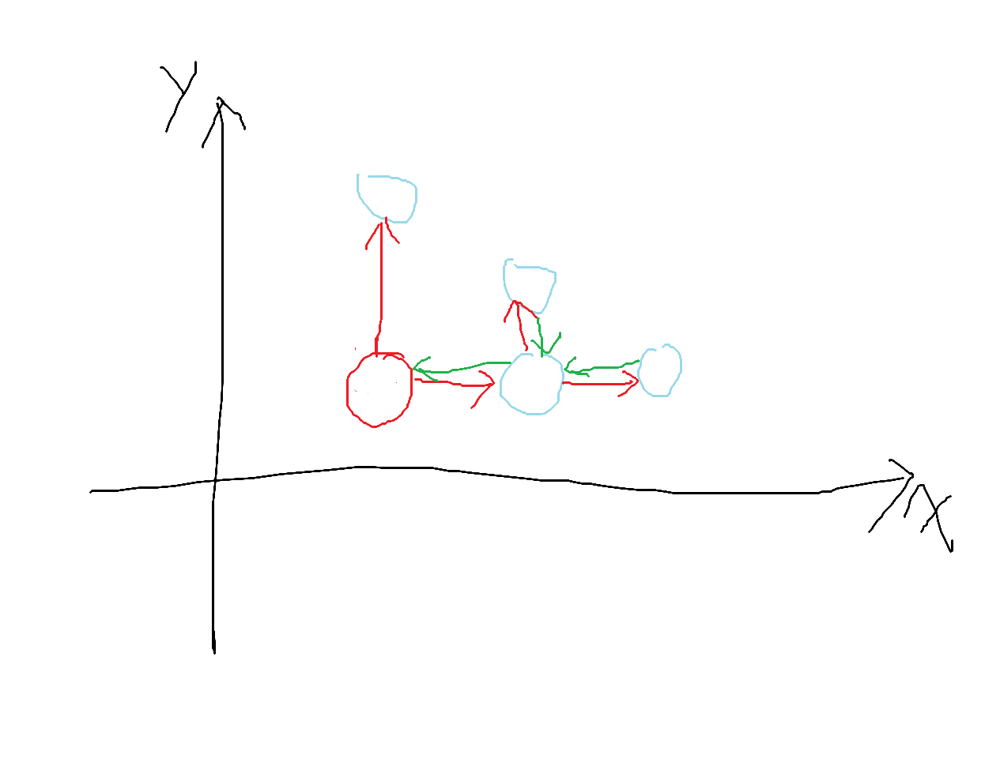

省外参考牌线：Au：$11$ 题；Ag：$8$ 题中 ~  $11$ 题最后一名；Cu：$6$ 题快 ~ $8$ 题慢

第一次参加ICPC线下赛，赛时 $7$ 题，整体还是挺满意的，比较遗憾的是队友赛时没能想明白M题。


**K.显卡**

有 $n$ 个显卡和 $m$ 个人，你需要把 $m$ 张显卡分给 $n$ 个账号，然后你使用显卡数量最少的一个账号，求你可以使用的最多的显卡数量。

**solution**

签到题，根据抽屉原理可知答案是 $n/m$ 。

```python
n,m=map(int,input().split())
print(n//m)
```


**J.数字谜题**

你和对手各有 $9\times n$ 张手牌，其中数字 $1$ 到 $9$ 各有 $n$ 张。每次出牌比较双方数字大小，数字大的一方获得自己打出的数字对应的积分，每个数字的积分等于对应手势伸出的手指数，如 $1$ ~ $5$ 对应积分 $1$ 至$5$ ，数字 $6$ 对应积分 $2$ ，等等。

现在你知道对手的出牌顺序，求你能够获得的最高总分。

**solution**

还是签到题，对于每一套 $1$ ~ $9$ 的牌，你可以让 $9$ 赢 $8$，$8$ 赢 $7$ ，以此类推，最后 $1$ 输给 $9$ ，可获得 $21$ 分，答案即为 $n\times 21$ 。

```python
n=int(input())
a=list(map(int,input().split()))
print(n*21)
```


**D.可爱的质数**

给定一个长为 $n$ 的数组 $a_1,a_2,\dots ,a_n$ 。你可以进行任意次操作，每次操作选择一个下标 $i$ 和一个质数 $p$ ，要求 $p<a_i$ ，然后把 $a_i$ 变成 $a_i$ mod $p$ 。

求出能让数组所有元素变成 $0$ 的最小操作次数，或者若做不到则输出 $-1$ 。

$n\le 5 \times  10^5$ ，$ 1 \le  a_i \le  10^7$

**solution**

观察到对于一个合数，可以直接选择它的一个质因数，一步把它变成 $0$ 。

对于一个质数，不难发现它不可能一步变成 $0$ ，那用两步能不能呢？

手玩一下发现 $2,3,5,7$ 是没法变成 $0$ 的，遇到它们应输出 $-1$ ；从 $11$ 开始，对于质数 $p$ ，存在一个质数 $q$ 满足 $p/2 \le  q \le  p-4$ ，然后可以将 $p$ 变为 $p-q$ ，这是一个大于 $4$ 的偶数，所以接下来再选择 $2$ 即可。

接下来要特判 $0$ 和 $1$ ，如果是 $0$ 则不用处理，是 $1$ 则无法处理输出 $-1$ 。

使用线性筛预处理后依次检验数组每个元素即可。

时间复杂度 $O(V+n)$ ，其中 $V=10^7$ 为值域。

```python
t=int(input())
MAXN=10**7+10
primes=[]
isprime=[True]*MAXN
for i in range(2,MAXN):
    if isprime[i]:
        primes.append(i)
    for p in primes:
        if i*p>=MAXN:
            break
        isprime[i*p]=False
        if i%p==0:
            break

for _ in range(t):
    n=int(input())
    a=list(map(int,input().split()))
    ans=0
    for i in range(n):
        if a[i]==0:
            continue
        elif a[i]==1 or a[i]==2 or a[i]==3 or a[i]==5 or a[i]==7:
            ans=-1
            break
        elif isprime[a[i]]:
            ans+=2
        else:
            ans+=1

    print(ans)


```


**L.情绪波动计划**

对于每组测试数据,给定两个整数 $n$、$k$ 和一个长度为 $n$ 的数组 $a$ ，你需要重新排列数组 $a$  ，让数组中“情绪波动”的次数恰好为 $k$ 次，其中“情绪波动”是指数组相邻两项为一奇一偶；或者判断无法构造。

**solution**

这道题赛时是队友给出的构造思路。首先注意到只需要关心元素的奇偶性，然后判断能够构造出的“情绪波动”的次数范围：设奇数出现次数为 $x$ ，偶数出现次数为 $y$ ，则上界为 $2\times min(x,y)-[x==y]$ ，下界为 $[x>0 \text{ and } y>0]$。

在判断能构造后，首先交错摆好 $k+1$ 个奇数和偶数，然后把剩下的奇数放在第一个奇数的后边，剩下的偶数放在第一个偶数的后边即可。

```python
t=int(input())
for _ in range(t):
    n,k=map(int,input().split())
    a=list(map(int,input().split()))
    odd,even=0,0
    o=[]
    e=[]
    for i in range(n):
        if a[i]%2:
            odd+=1
            o.append(a[i])
        else:
            even+=1
            e.append(a[i])

    maxn=min(odd,even)*2

    if odd==even:
        maxn-=1
    
    if min(odd,even)==0:
        minn=0
    else:
        minn=1

    if k==0 and minn==0:
        print(*a)
        continue
    if minn<=k and k<=maxn:
        ans=[]
        po,pe=0,0
        if k%2:
            need1=(k+1)//2
            need2=(k+1)//2
        else:
            need1=k//2+1
            need2=k//2
        if odd>even:
            for i in range(odd-need1+1):
                ans.append(o[po])
                po+=1
            for i in range(even-need2+1):
                ans.append(e[pe])
                pe+=1
            #print(ans)
            for i in range(need1+need2-2):
                if i%2:
                    ans.append(e[pe])
                    pe+=1
                else:
                    ans.append(o[po])
                    po+=1
        else:
            for i in range(even-need1+1):
                ans.append(e[pe])
                pe+=1
            for i in range(odd-need2+1):
                ans.append(o[po])
                po+=1
            for i in range(need1+need2-2):
                if i%2:
                    ans.append(o[po])
                    po+=1
                else:
                    ans.append(e[pe])
                    pe+=1
        print(*ans)
    else:
        print(-1)
```


**B.VP选手的最优解题方案**

你现在有 $n$ 道题目和 $t$ 分钟时间，每道题目 $i$ 都有 $a_i$ 的思考时间和 $c_i$ 的编码时间。在这道题中你必须顺序看题，每道题都需要思考完，即花费 $a_i$ 的时间，然后你需要决定是否再花 $c_i$ 的时间去编码解决它。

现在需要求出能编码出的题目的最多数量。

$1\le n\le 2\times 10^5$ , $1\le a_i,c_i\le 10^9$

**solution**

看到这个题目第一感很难不是背包，但细想发现不可行，因为 $a_i$ 和 $c_i$ 的值域很大。

思考如果考虑到了第 $i$ 题，那么显然应该贪心地选取 $[1,i]$ 里编码时间最短的题目，此时发现如果一道题在此时没有被选到，那么它在后边就更不可能被选到了（因为可用时间变短并且后边可能会有编码时间更短的题目）。

由此想到使用大根堆维护考虑到第 $i$ 题时当前所有被选中的题目，后续题目加入大根堆后若发现总编码时长超过剩余时间，则不断弹出堆顶直到总编码时长小于等于剩余时间。

时间复杂度 $O(n\log n)$

```python
import heapq
n,t=map(int,input().split())
a=list(map(int,input().split()))
c=list(map(int,input().split()))

heap=[]
rest=t
cur=0
ans=0
for i in range(n):
    rest-=a[i]  #Python默认小根堆，所以要存负值
    heapq.heappush(heap,-c[i])
    cur+=c[i]
    while heap and cur>rest:
        ci=heapq.heappop(heap)
        cur+=ci

    ans=max(ans,len(heap))

print(ans)
```


**F.咏人不知**

（题目内定义较多，所以选择复制原题面）

在 7sRef 世界的法则中，音乐使用七个音级 $1,2,\dots,7$。对整数 $x$ 定义

$$[x]_7 = ((x-1) \bmod 7) + 1,$$

音级 $x,y$ 之间的距离为

$$D(x,y)=\min\bigl(|x-y|,\ 7-|x-y|\bigr).$$

一个和弦由一个整数 $c\in[1,7]$ 表示，共有三种转位 $t\in\{0,1,2\}$。和弦 $c$ 采用转位 $t$ 时的**最低音**为

$$B(c,t)=[c+2t]_7,$$

即最低音可取 $c,\ [c+2]_7,\ [c+4]_7$ 之一。

同一个和弦可以通过改变最低音得到不同的转位；连接相邻和弦时，合适的转位能使最低声部移动更平滑。

若十进制正整数 $x$ 的每一位都属于 $1\sim 7$，则称 $x$ 为**合法乐谱编号**。设 $x$ 的十进制表示为 $a_1a_2\cdots a_n$，将其看作和弦序列 $a_1\to a_2\to\cdots\to a_n$。

对于某个乐谱，Liz 希望为每个和弦选择合适的转位，使整段进行中最低音的音级距离之和尽可能小。她想知道，给定一个乐谱编号，这种最小代价是多少。

形式化地，为每个和弦 $a_i$ 独立选择转位 $t_i\in\{0,1,2\}$，则该进行的总代价为

$$\sum_{i=1}^{n-1} D\bigl(B(a_i,t_i),\ B(a_{i+1},t_{i+1})\bigr).$$

令 $H(x)$ 为所有转位方案中总代价的最小值（$x$ 只有一位时 $H(x)=0$）。

$1\le |x|\le 2\times 10^5$。

**solution**

这次真是dp，对于每个 $1\le i \le n $ ，考虑第 $i$ 位和第 $i-1$ 位分别使用的转位即可。

时间复杂度 $O(9n)$

```python
t=int(input())
INF=10**18
def D(x,y):
    return min(abs(x-y),7-abs(x-y))

def B(x):
    return (x-1)%7+1

for _ in range(t):
    s=input().strip()
    L=len(s)
    dp=[[INF,INF,INF] for _ in range(L)]
    dp[0][0]=0
    dp[0][1]=0
    dp[0][2]=0

    for i in range(1,L):
        for j in range(3):
            for k in range(3):

                dp[i][j]=min(dp[i][j],
                             dp[i-1][k]+D(B(int(s[i])+2*j,B(int(s[i-1])+2*k)))

    print(min(dp[L-1]))
```


**A.海鸥传说**

有 $n$ 只海鸥和一个无限食物堆在一个行列编号均为整数的无限二维网格中和一个初始为空的操作栈，你需要指挥所有在场的海鸥前进或者撤退。

前进：代价为 $1$ 。效果为指挥所有在场的海鸥向某个方向移动任意格，然后将本次操作的（方向，距离）压入操作栈。

撤退：代价为 $0$ ，且执行时操作栈非空。效果为弹出栈顶的操作，然后指挥所有在场的海鸥按照弹出的（方向，距离）沿该方向的相反方向移动该距离。

每次操作结束后，如果有海鸥位于食物格，那么它会吃掉一份食物后飞离网格，注意海鸥飞行过程中若经过食物格不会吃掉食物。

你需要求出让所有海鸥吃到食物的最小总代价。

$1\le n \le5\times  10^5$ ，$1\le r_i,c_i \le5\times  10^5$


**solution**

赛时写这道题的时候出现了严重的思路出错，导致浪费了将近两个小时的时间，这两个小时也导致我们从银牌区掉到了铜牌区。

首先，海鸥的整体移动，等价于食物堆单体反向移动，所以可以从操作一群海鸥改成操作一个食物堆。

然后先只关注任意一只海鸥，它想吃到食物至少要走 $1$ 步，且最多要走 $2$ 步，问题的焦点自然到了如何让更多的海鸥只走一步而不是走两步。

由于“撤退”这一操作的存在，如果食物堆“来过”了位置$(x,y)$ ，那么它将可以以 $1$ 点代价到达横坐标为 $x$ 和纵坐标为 $y$ 的所有点。



图中红色为食物堆“前进”路线，绿色为食物堆“撤退”路线。

理解了这个事情后，问题转化成了求海鸥和食物堆共 $n+1$ 个点的连通块数量 $cnt$ 。如果只有一个连通块，则答案为 $n$ ；每多出一个连通块，就需要多花 $1$ 步去连接它们。

所以最后的总代价就是 $n+cnt-1$。

赛时代码（仅供参考）：

```python
MAXN=500010
locr=[[] for _ in range(MAXN)]
locc=[[] for _ in range(MAXN)]
visr=[-1]*MAXN
visc=[-1]*MAXN
T=int(input())
for t in range(T):
    n=int(input())
    loc=[]
    for i in range(n):
        r,c=map(int,input().split())
        locr[r].append((c,i,t))
        locc[c].append((r,i,t))
        loc.append((r,c))
    vis=[False]*(n+1)
    fx,fy=map(int,input().split())
    locr[fx].append((fy,n,t))
    locc[fy].append((fx,n,t))
    loc.append((fx,fy))
    cnt=0
    stack=[]
    for i in range(n+1):
        if vis[i]==False:
            vis[i]=True
            x,y=loc[i]
            if visr[x]!=t:
                visr[x]=t
                stack.append((0,x))
            if visc[y]!=t:
                visc[y]=t
                stack.append((1,y))

            while stack:
                op,location=stack.pop()
                if op==0:
                    curx=location
                    L=len(locr[curx])
                    for j in range(L-1,-1,-1):
                        cury,idx,turn=locr[curx][j]                    
                        if turn!=t:
                            break
                        if vis[idx]==False:
                            vis[idx]=True
                        if visc[cury]!=t:
                            visc[cury]=t
                            stack.append((1,cury))
                else:
                    cury=location
                    L=len(locc[cury])
                    for j in range(L-1,-1,-1):
                        curx,idx,turn=locc[cury][j]                    
                        if turn!=t:
                            break
                        if vis[idx]==False:
                            vis[idx]=True
                        if visr[curx]!=t:
                            visr[curx]=t
                            stack.append((0,curx))
            cnt+=1
    print(n+cnt-1)                
```

由于数组长度过大，不能每组测试数据都重新初始化一次，所以使用了把测试数据组数作为时间戳也存储进入数据的策略。

使用并查集的做法（代码由AI生成）：

```cpp
#include <bits/stdc++.h>
using namespace std;

int par[2000005];
int find(int x) { while (par[x] != x) { par[x] = par[par[x]]; x = par[x]; } return x; }
void uni(int a, int b) { a = find(a); b = find(b); if (a != b) par[a] = b; }

int main() {
    int T; if (scanf("%d", &T) != 1) return 0;
    while (T--) {
        int n; scanf("%d", &n);
        vector<int> r(n), c(n);
        for (int i = 0; i < n; ++i) scanf("%d %d", &r[i], &c[i]);
        int fr, fc; scanf("%d %d", &fr, &fc);

        // 位移状态格点：(0,0) 与所有 food - pos_i
        vector<int> rv(n + 1), cv(n + 1);
        rv[0] = 0; cv[0] = 0;
        for (int i = 0; i < n; ++i) { rv[i + 1] = fr - r[i]; cv[i + 1] = fc - c[i]; }

        vector<int> rows(rv), cols(cv);
        sort(rows.begin(), rows.end()); rows.erase(unique(rows.begin(), rows.end()), rows.end());
        sort(cols.begin(), cols.end()); cols.erase(unique(cols.begin(), cols.end()), cols.end());
        int NR = rows.size(), NC = cols.size(), V = NR + NC;
        for (int i = 0; i < V; ++i) par[i] = i;
        for (int i = 0; i <= n; ++i) {
            int a = lower_bound(rows.begin(), rows.end(), rv[i]) - rows.begin();
            int b = lower_bound(cols.begin(), cols.end(), cv[i]) - cols.begin();
            uni(a, NR + b);                     // 行点 —— 列点
        }
        int m = 0;
        for (int i = 0; i < V; ++i) if (find(i) == i) ++m;
        printf("%d\n", n + m - 1);
    }
}

```


**M.毛毛虫想吃麦香鱼**

通信题

first：你会拿到一棵层数不超过 $3$ 的树，这棵树采用BFS遍历得到的序列为 $1,2,\dots ,n$ ，这棵树用一个长度为 $n-1$ 的序列 $p$ 给出，其中 $p_i$ 表示节点 $i+1$ 的父节点为 $p_i$ 。

你需要输出一个长度不超过 $n-1$，元素在 $[1,n-1]$ 内且无重复元素的非空整数序列，然后评测机会打乱你传出的序列的顺序。

second：你会收到你在第一次运行时传出的序列，并且你不知道这组测试数据对应的树的节点数，你需要通过这个序列还原出它对应的树。注意测试数据的顺序也会被打乱，但是一定能对应第一次运行时你传出的某一个序列。

$1\le n\le 10^5$

**solution**

难点在于评测机会打乱第一次运行时传出的序列的顺序，以及传出序列的元素值域问题以及不能重复。

通信思路并不只有一种，但都要聚焦于如何解决上边两个难点。对于值域和不重复问题，想到使用前缀和记录第二层每个节点的子树节点数量，这样当跑完第二层所有节点时，序列的长度恰好能对应第二层的节点数量，且最后一个值恰好是 $n-1$ ，不会存在超值域的问题，而由于前缀和的性质，每次访问下一个节点，前缀和至少会增加 $1$ （也就是该节点在第三层没有子节点），所以也不会存在值重复的问题；对于打乱顺序，只需要在接收序列时将其排序，即可还原传出时的序列。

在还原树时，将前缀和作差分还原为第二层每一个节点的子树大小，然后就可以还原整棵树。

由于需要排序，所以时间复杂度为 $O(n\log n)$

```python
import sys
sys.stdout.flush()
op=input()
if op=="first":
    t=int(input())
    for _ in range(t):
        n=int(input())
        a=list(map(int,input().split()))
        soncnt=[0]*(n+1)
        divide=n
        for i in range(n-1):
            soncnt[a[i]]+=1
            if divide==n and a[i]!=1:
                divide=i+1
        cur=0
        message=[]
        for i in range(2,divide+1):        
            cur+=(1+soncnt[i])
            message.append(cur)

        print(len(message))
        sys.stdout.flush()
        print(*message)
        sys.stdout.flush()
else:
    t=int(input())
    for _ in range(t):
        m=int(input())
        b=list(map(int,input().split()))
        b.sort()
        ans=[]
        divide=len(b)+1
        for i in range(2,divide+1):
            ans.append(1)

        cur=0
        for i in range(2,divide+1):
            cur+=1
            for j in range(cur,b[i-2]):
                ans.append(i)
            cur=b[i-2]

        print(len(ans)+1)
        sys.stdout.flush()
        print(*ans)
        sys.stdout.flush()

```

除此之外，也可以改造初始的父节点序列（官方题解思路二）；也可以在遍历第二层节点时，若它有子节点，则记录编号最大的子节点编号，否则就记录该节点本身编号，此时传出的序列长度 $k$ 同样对应第二层节点数量。恢复时，将收到的序列分为大于 $k$ 和小于等于 $k$ 两个部分分别排序，然后遍历节点 $[2,k]$ ，判断它有没有子节点（来自群友的思路）。


总的来说这次没打铁就是好结局，也是认识到了自己和其他强队的差距，希望下次参加比赛时面对比较有难度的题目不会做的这么手忙脚乱（

补题链接： [（2026）第七届辽宁省大学生程序设计竞赛 (沈阳) - Dashboard - Contest - QOJ.ac](https://qoj.ac/contest/4707) 
